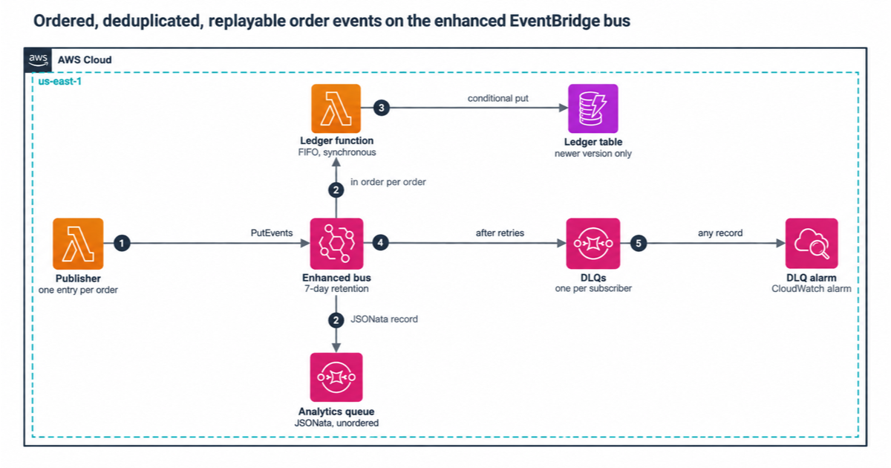

# Ordered, deduplicated, replayable events on the enhanced EventBridge bus

A tested AWS CDK app for the enhanced Amazon EventBridge custom event bus (the `eventsv2` API). AWS [announced it on 24 September 2026](https://aws.amazon.com/about-aws/whats-new/2026/09/eventbridge-relaunches-custom-event-buses/) in 14 Regions. One publisher sends order events. Two subscribers read them:

- **ledger**: a FIFO subscriber. It calls an AWS Lambda function and waits for it to return, one order's events at a time and in order, and the function keeps each order's latest state in Amazon DynamoDB.
- **analytics**: an unordered subscriber. It reshapes each event with JSONata and drops it on an Amazon SQS queue.

The bus keeps every event for 7 days. To rebuild the ledger, you add a subscriber that starts in the past. A separate replay API doesn't exist.

```
publisher Lambda --PutEvents--> enhanced bus (7-day retention)
                                  |-- FIFO subscriber ------> ledger Lambda (REQUEST_RESPONSE) --> DynamoDB
                                  |                            failures -> FIFO dead-letter queue
                                  |-- UNORDERED subscriber --> JSONata --> SQS analytics queue
                                                               failures -> dead-letter queue
```

## Architecture



## What the code shows

| Problem | What this repo does | Where |
|---|---|---|
| A retried publish creates a duplicate | Every entry carries `DeduplicationId` = the producer's event ID. A repeat within 5 minutes comes back `DEDUPLICATED`, and the publisher counts that as success | `src/publisher/publish.ts` |
| PutEvents accepts or rejects each entry on its own | Each call holds at most one entry per order, and an order's next version waits until EventBridge accepts the previous one. A retry can't land v1 after v2 | `src/publisher/publish.ts` |
| Ordered processing in Lambda | `Type: FIFO`, `EventGroupId` = order ID, and `InvocationType: REQUEST_RESPONSE`. With `EVENT`, order only holds until Lambda's async queue | `infra/lib/orders-bus-stack.ts` |
| Replays and retried batches deliver events again | The ledger write is conditional on a newer version, tested on DynamoDB Local | `src/ledger/store.ts` |
| A failed event vanishes | Both subscribers have a retry policy and a dead-letter queue, and each dead-letter queue has an alarm | `infra/lib/orders-bus-stack.ts` |
| CDK has no complete construct for subscribers | `cdk.CfnResource` with the documented `AWS::EventsV2` property names, wrapped in small typed classes | `infra/lib/eventsv2.ts` |

## About the CDK constructs

aws-cdk-lib 2.273.0 (the newest release on 2026-10-16) has an `aws-eventsv2` module with generated L1 classes. Its `CfnSubscriber` has no `invokeConfiguration` property, and CloudFormation requires `InvokeConfiguration` on every subscriber. So this repo declares `AWS::EventsV2::EventBus` and `AWS::EventsV2::Subscriber` with `cdk.CfnResource`, with property names taken from the [CloudFormation template reference](https://docs.aws.amazon.com/AWSCloudFormation/latest/TemplateReference/aws-resource-eventsv2-subscriber.html). `infra/lib/eventsv2.ts` checks the documented limits at synth time, such as 0 to 185 retry attempts and one filter per scope.

## The bus model used in tests

No local emulator exists for the enhanced bus, so `src/model/bus-model.ts` is a **model** of the documented behaviour for tests to run against. It is not EventBridge. It covers deduplication (by ID or content, 300 s window, scoped to account and event group), retention, FIFO and unordered delivery, starting positions and `REPLAY` marking, retries and dead-letter records, and filters. The model marks each choice the docs leave open with an `ASSUMPTION` comment.

Tests built on the model show that our code handles those semantics. Only `npm run smoke` against a deployed stack shows that the service behaves the same way.

## Run it

You need Node.js 24 and npm. Docker is only needed for the integration tests.

```bash
npm ci
npm run check      # type check, lint, bundle, unit + infra tests, synth with cdk-nag
docker run -d --rm -p 8025:8000 amazon/dynamodb-local:3.3.2
AWS_ENDPOINT_URL_DYNAMODB=http://localhost:8025 npm run test:int
npm run cost       # monthly cost tables, enhanced vs Classic bus
```

To deploy, you need a CDK-bootstrapped account in a Region that has the enhanced bus (us-east-1 is one):

```bash
npm run deploy                                   # optional: -c alertEmail=you@example.com -c retentionDays=14
npm run smoke                                    # publishes twice, checks dedup, the ledger and the analytics queue
npm run destroy
```

To rebuild the ledger from the bus, deploy with `-c replayFromEpochSeconds=<unix seconds>`. That adds a second FIFO subscriber starting at that time, feeding the same ledger function. Remove the flag and deploy again once it has caught up. [docs/runbook.md](docs/runbook.md) covers this, redrive and pausing.

## Cost

You pay for the data you publish and deliver, and for retention past the first 24 hours. The bus rounds every event up to a whole KB. At 10 million 1 KB events a month with two subscribers and 7 days of retention, the bus costs about $2.96 a month in us-east-1. At 16 KB per event it's $47.36, while the Classic bus stays at $10.00 for events up to 64 KB. [docs/cost.md](docs/cost.md) shows the math and the sources.

## Docs

- [docs/cost.md](docs/cost.md): prices, the cost model, and when the Classic bus is cheaper
- [docs/security.md](docs/security.md): IAM, encryption, and what the filters do and don't protect
- [docs/runbook.md](docs/runbook.md): dead-letter alarms, redrive by replay, pausing a subscriber

## License

You can use the code under MIT-0, which asks for no attribution. The full text is in [LICENSE](LICENSE).

---

Created by Rahul Ladumor / InfraTales
